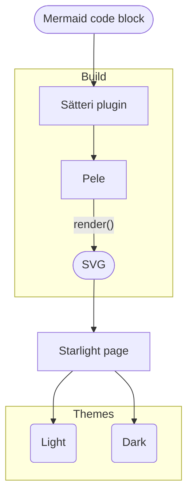

Multiple solutions exist to embed [Mermaid](https://mermaid.js.org/) diagrams declaratively in your Markdown content and render them on your documentation website.
Most of the time, rendering such diagrams comes with various trade-offs, like embedding JavaScript on your pages to render the diagrams, using fairly slow solutions relying on a headless browser like [Playwright](https://playwright.dev/) to render the diagrams at build time, or not having proper dark mode support.

This guide will show you how to render Mermaid diagrams at build time in your [Starlight](https://starlight.astro.build/) documentation using [Pele](https://pele.run/).

Pele is an open source Mermaid renderer developed for [Obsidian](https://obsidian.md/) that outputs SVG.
It has no dependencies, does not rely on a browser, and supports every diagram type built into Mermaid.
According to its [website](https://pele.run/#why-pele), it is also up to 500x faster than Mermaid.js.
Diagrams are styled using CSS variables so they can match your project colors in both light and dark mode without being rendered twice.

:::note[Related]
[Add diagrams to your Starlight documentation using D2](/notes/starlight-add-diagrams-using-d2).
:::

## Prerequisites

You will need to have an existing Starlight website.

## Install dependencies

Astro, which Starlight is built on top of, uses [Sätteri](https://satteri.bruits.org/) as its default Markdown processor.
A Sätteri [plugin](https://satteri.bruits.org/docs/plugins/) will be used to transform Mermaid code blocks into diagrams at build time.

Start by installing the `pele` package to render diagrams, the `@astrojs/markdown-satteri` package to configure Sätteri in Astro, and the `satteri` package to create the plugin:

import Pkg from '@components/Pkg.astro'

<Pkg pkg="pele @astrojs/markdown-satteri satteri" />

## Create the plugin

Sätteri plugins can transform either the Markdown or the HTML [syntax tree](https://satteri.bruits.org/docs/asts/) of your content.

The following plugin visits every Markdown code block and replaces the ones using the `mermaid` language with an SVG diagram rendered using the Pele [`render()`](https://pele.run/api#render) function.

```ts
// src/plugins/mermaid.ts
import { defineMdastPlugin } from 'satteri'
import { render } from 'pele'

export function mermaid() {
  // Keep track of the number of Mermaid diagrams per page to generate unique SVG IDs.
  let count = 0

  return defineMdastPlugin({
    name: 'mermaid',
    // Visit every code block in the Markdown syntax tree.
    code(node) {
      // Leave non-Mermaid code blocks unchanged.
      if (node.lang !== 'mermaid') return

      // Render the Mermaid diagram to SVG using Pele.
      const { svg } = render(node.value, { idPrefix: `pele-${count++}` })

      // Replace the Mermaid code block with the rendered SVG as raw HTML.
      return { type: 'html', value: svg }
    },
  })
}
```

## Match Starlight theme

Pele diagrams are styled using [CSS variables](https://pele.run/theming#variables) just like [Starlight itself](https://github.com/withastro/starlight/blob/main/packages/starlight/src/style/props.css).
Mapping Pele CSS variables to Starlight ones makes diagrams match your project colors and automatically follow the selected theme.

The following example is a minimal version matching Starlight's default theme that can be expanded on using the [Pele theming documentation](https://pele.run/theming).

```css
/* src/styles/pele.css */
/* https://pele.run/theming#variables */
.pele {
  --pele-bg: var(--sl-color-bg);
  --pele-fg: var(--sl-color-text);
  --pele-muted: var(--sl-color-gray-3);
  --pele-line: var(--sl-color-gray-2);
  --pele-surface: var(--sl-color-gray-6);
  --pele-surface-alt: var(--sl-color-gray-5);
  --pele-border: var(--sl-color-gray-4);
  --pele-accent: var(--sl-color-accent);
  --pele-critical: var(--sl-color-red);
  --pele-font: var(--sl-font, var(--sl-font-system));
  --pele-font-mono: var(--sl-font-mono, var(--sl-font-system-mono));
}
```

## Configure Astro

To use the Mermaid plugin and the Pele CSS file in your Starlight project, you need to configure both of them in your `astro.config.mjs` file.

Import the plugin and add it to the `mdastPlugins` array of the Sätteri processor configured using the [`markdown.processor`](https://docs.astro.build/en/reference/configuration-reference/#markdownprocessor) option.
Add the CSS file to the Starlight [`customCss`](https://starlight.astro.build/reference/configuration/#customcss) configuration option.

```js ins={4-5,8-13,17-18}
// astro.config.mjs
import { defineConfig } from 'astro/config'
import starlight from '@astrojs/starlight'
import { satteri } from '@astrojs/markdown-satteri'
import { mermaid } from './src/plugins/mermaid'

export default defineConfig({
  markdown: {
    // Add the Mermaid plugin to Astro default Markdown processor.
    processor: satteri({
      mdastPlugins: [mermaid],
    }),
  },
  integrations: [
    starlight({
      title: 'My Docs',
      // Match Pele CSS variables to Starlight light and dark themes.
      customCss: ['./src/styles/pele.css'],
    }),
  ],
})
```

## Add diagrams

To declare a diagram, you can use a Markdown code block which is indicated by a block with three backticks <code>```</code> at the start and end and by specifying the `mermaid` language after the opening backticks.

````md {10-23}
---
// src/content/docs/example.md
title: My content page
---

## My heading

The content of my Starlight page.


````

The above example will render the following content:

import Example from './examples/_starlight-add-mermaid-diagrams-using-pele.astro'

<Example />

The diagram colors follow the selected theme, which you can try by switching between the light and dark themes on this page.

You can learn more about Mermaid syntax and features by visiting the [official Mermaid documentation](https://mermaid.js.org/intro/syntax-reference.html) and the [Pele examples](https://pele.run/examples).

Up to you to expand the CSS to match your own Starlight theme or to pass additional [Pele options](https://pele.run/api#renderoptions) to tweak diagrams to your needs.

You can find the complete source code of this guide in this [StackBlitz example](https://stackblitz.com/edit/github-gfmrdigu?file=src%2Fplugins%2Fmermaid.ts).
