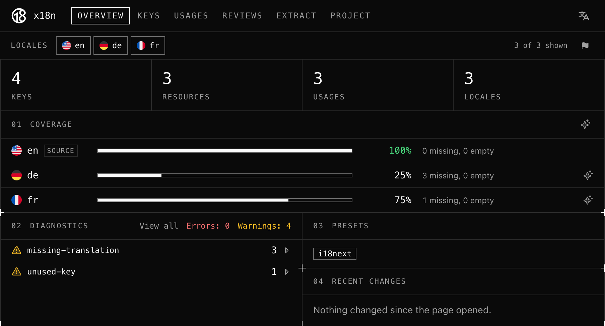
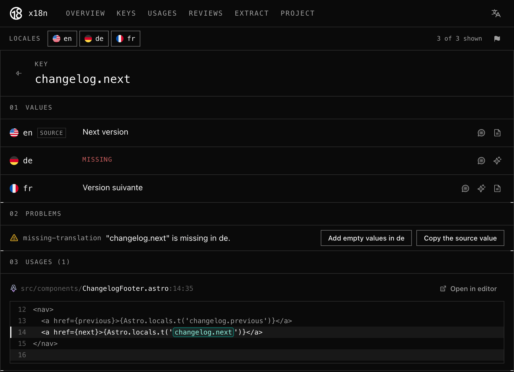

[Starlight](https://starlight.astro.build) provides [built-in support](https://starlight.astro.build/guides/i18n/) for multilingual documentation websites, including translated UI strings for all its components in [many languages](https://starlight.astro.build/guides/i18n/#translate-starlights-ui).
When building custom components, you can [extend](https://starlight.astro.build/guides/i18n/#extend-translation-schema) these UI strings with your own, translate them in each language supported by your website, and [use them](https://starlight.astro.build/guides/i18n/#using-ui-translations) in your components with the `Astro.locals.t()` helper.

As your project grows, it becomes easy to forget to translate a new string in every language or to remove a string that is no longer used.
[x18n](https://x18n.dev) can help you spot such issues.

This guide will show you how to use x18n to find translation issues in a multilingual Starlight project.

## Prerequisites

You will need to have an existing multilingual Starlight website using [custom translation strings](https://starlight.astro.build/guides/i18n/#extend-translation-schema).

## Example project

To illustrate how x18n works, this guide will use an example Starlight project with a custom changelog page listing changes in each version of a package.

### Languages

The example project is available in three languages: English as the [root locale](https://starlight.astro.build/guides/i18n/#use-a-root-locale), French, German, and uses the following configuration:

```js {9-13}
// astro.config.mjs
import starlight from '@astrojs/starlight'
import { defineConfig } from 'astro/config'

export default defineConfig({
  integrations: [
    starlight({
      title: 'My Docs',
      locales: {
        root: { label: 'English', lang: 'en' },
        fr: { label: 'Français', lang: 'fr' },
        de: { label: 'Deutsch', lang: 'de' },
      },
    }),
  ],
})
```

### Custom UI strings

The changelog page uses custom UI strings prefixed with `changelog.` to display the release date of a version and links to navigate between versions.
The following `i18n` data collection configuration extends Starlight translation schema with these new keys:

```ts {13-16}
// src/content.config.ts
import { defineCollection } from 'astro:content'
import { z } from 'astro/zod'
import { docsLoader, i18nLoader } from '@astrojs/starlight/loaders'
import { docsSchema, i18nSchema } from '@astrojs/starlight/schema'

export const collections = {
  docs: defineCollection({ loader: docsLoader(), schema: docsSchema() }),
  i18n: defineCollection({
    loader: i18nLoader(),
    schema: i18nSchema({
      extend: z.object({
        'changelog.all': z.string().optional(),
        'changelog.previous': z.string().optional(),
        'changelog.next': z.string().optional(),
        'changelog.date': z.string().optional(),
      }),
    }),
  }),
}
```

The translations for each language are stored in a JSON file in the `src/content/i18n/` directory.
The English translation file includes all the custom UI strings:

```json title="src/content/i18n/en.json"
{
  "changelog.all": "All versions",
  "changelog.previous": "Previous version",
  "changelog.next": "Next version",
  "changelog.date": "Released on {{date}}"
}
```

The French translation file is missing the release date string:

```json title="src/content/i18n/fr.json"
{
  "changelog.all": "Toutes les versions",
  "changelog.previous": "Version précédente",
  "changelog.next": "Version suivante"
}
```

The German translation file only includes a single string:

```json title="src/content/i18n/de.json"
{
  "changelog.all": "Alle Versionen"
}
```

### Changelog component

The custom UI strings are used in an Astro component rendered at the bottom of each changelog entry.

The `Astro.locals.t()` helper is used to display the release date of a version and links to the previous and next versions:

```astro /'changelog.*'/
---
// src/components/ChangelogFooter.astro
interface Props {
  date: string
  previous: string
  next: string
}

const { date, previous, next } = Astro.props
---

<p>{Astro.locals.t('changelog.date', { date })}</p>
<nav>
  <a href={previous}>{Astro.locals.t('changelog.previous')}</a>
  <a href={next}>{Astro.locals.t('changelog.next')}</a>
</nav>
```

A previous version of this component included a link to the page listing all versions, leaving the `changelog.all` key unused.

## Configure x18n

x18n can be [configured](https://x18n.dev/guide/configuration) using many different formats, but this guide uses a YAML configuration file located at the root of the project.

The following configuration sets up x18n for the project by specifying the source locale, the location of the translation files, the [`i18next`](https://www.i18next.com/) preset for the library used by Starlight to handle UI string translations, and the helper used to render UI strings.

```yaml title="x18n.config.yml"
# yaml-language-server: $schema=https://x18n.dev/schema/config.json

# The default language of the project.
sourceLocale: en
resources:
  # The location of the translation files for each language.
  - pattern: src/content/i18n/{locale}.json
presets:
  # Starlight uses i18next for UI strings.
  - i18next
usage:
  calls:
    # The helper used to render UI strings in Starlight.
    - callee: Astro.locals.t
```

## Check translations

With x18n configured, you can run the [`check` command](https://x18n.dev/surfaces/cli#x18n-check) at the root of your project to find translation issues:

import Pkg from '@components/Pkg.astro'

<Pkg type="dlx" pkg="@x18n/cli" args="check" />

The command reports each issue found in the translation files:

```ansi title="Terminal"
src/content/i18n/en.json:2:4
 WARNING  "changelog.all" is not used.  unused-key
1 │ {
2 │   "changelog.all": "All versions",
  │    ~~~~~~~~~~~~~
3 │   "changelog.previous": "Previous version",

src/content/i18n/en.json:3:4
 WARNING  "changelog.previous" is missing in de.  missing-translation
2 │   "changelog.all": "All versions",
3 │   "changelog.previous": "Previous version",
  │    ~~~~~~~~~~~~~~~~~~
4 │   "changelog.next": "Next version",

src/content/i18n/en.json:4:4
 WARNING  "changelog.next" is missing in de.  missing-translation
3 │   "changelog.previous": "Previous version",
4 │   "changelog.next": "Next version",
  │    ~~~~~~~~~~~~~~
5 │   "changelog.date": "Released on {{date}}"

src/content/i18n/en.json:5:4
 WARNING  "changelog.date" is missing in de, fr.  missing-translation
4 │   "changelog.next": "Next version",
5 │   "changelog.date": "Released on {{date}}"
  │    ~~~~~~~~~~~~~~
6 │ }

⚠ 4 warnings  1 file
```

The reported issues match the ones introduced in the example project:

- The `changelog.all` key is reported by the [`unused-key`](https://x18n.dev/checks/unused-key) check as it is defined in the English translation file but no longer used by any component.
- The `changelog.previous` and `changelog.next` keys are reported by the [`missing-translation`](https://x18n.dev/checks/missing-translation) check as they are missing from the German translation file.
- The `changelog.date` key is reported by the `missing-translation` check as it is missing from the French and German translation files.

:::note[Tip]
x18n can also be run in a [continuous integration](https://x18n.dev/surfaces/ci) workflow, e.g. to fail a build when translation issues are found.
:::

## Use the x18n UI

x18n also comes with a [UI](https://x18n.dev/surfaces/ui) where you can get an overview of all translation issues, browse and edit translation keys across languages, and see where each key is used.

To start the UI, run the following command at the root of your project:

<Pkg type="dlx" pkg="@x18n/cli" args="ui" />

The UI opens in your browser with an overview of the project including the translation coverage of each language and the issues found:

import Screenshot from './examples/_starlight-translation-issues-x18n.astro'

<Screenshot>



</Screenshot>

The "Keys" page lists all translation keys, and selecting one of them opens a page with its translation in each language, its issues, and where it is used in the project:

<Screenshot>



</Screenshot>

Up to you to explore the other [features](https://x18n.dev/guide) provided by x18n, e.g. a [Visual Studio Code extension](https://x18n.dev/surfaces/vscode) showing translations in your editor.
